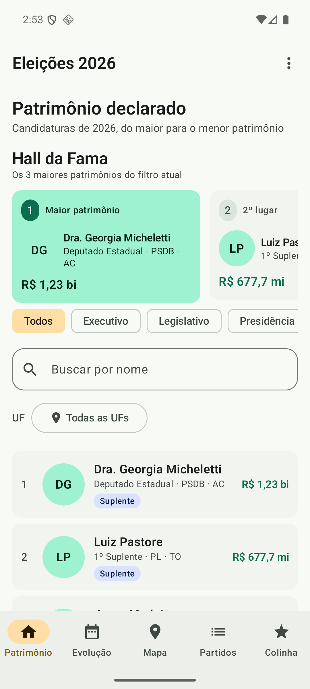
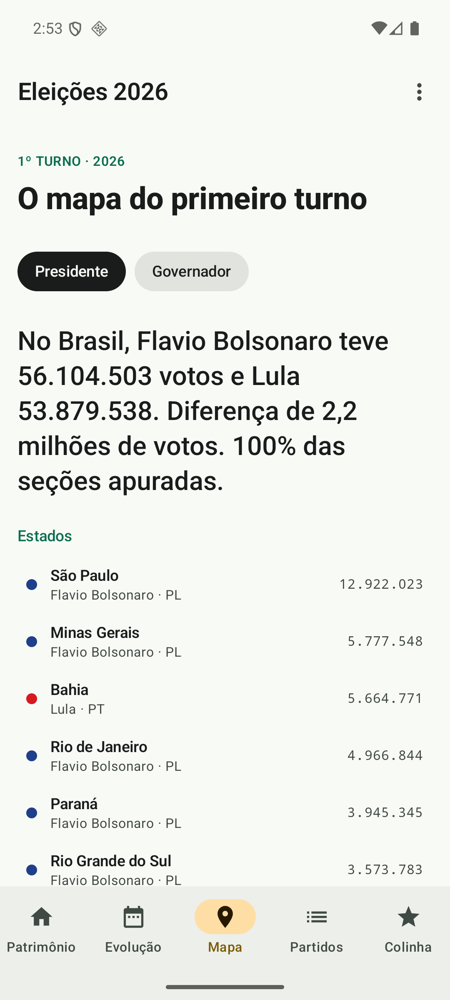
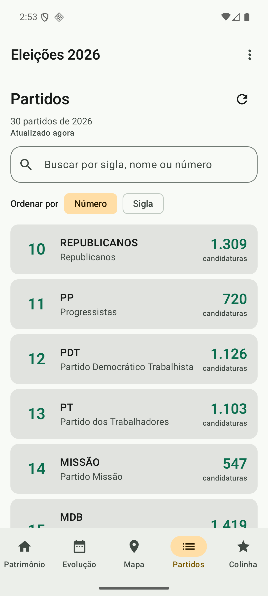

# Eleições 2026 — app KMP

App Android em Kotlin Multiplatform que mostra os dados públicos do TSE das eleições de 2026, servidos pela API
[eleicoes.dev](https://eleicoes.dev). Projeto Final da disciplina Arquitetura de Aplicações Móveis e
Multiplataforma (PUC Minas).

O app responde a perguntas como “quem declarou mais patrimônio?”, “quanto esse candidato ficou mais rico desde
2006?” e “quem liderou o 1º turno em cada estado?”. As regras, a camada de dados e a interface (Compose
Multiplatform com Material 3) ficam no módulo `shared`; o `androidApp` e o `iosApp` só hospedam a tela, e o app
também roda no simulador de iPhone. As decisões de arquitetura e as alternativas descartadas estão no
[ADR](ADR.md).

## O que o app faz

| Tela | O que mostra |
|---|---|
| **Patrimônio** (aba) | Ranking dos candidatos pelo patrimônio declarado, com busca por nome e filtros por cargo, gênero e UF. O **Hall da Fama** destaca os 3 maiores patrimônios do filtro atual. |
| **Detalhe** | Ao tocar num candidato: perfil, resultado da eleição e a lista de bens declarados, com o total. |
| **Evolução** (aba) | Quanto o patrimônio do candidato mudou de uma eleição para outra, desde 2006. |
| **Mapa** (aba) | Quem liderou o 1º turno no Brasil e em cada UF, com o total de votos e o percentual de seções apuradas. |
| **Partidos** (aba) | Os partidos e os seus candidatos, com busca, contagem de candidaturas e recarga. |
| **Colinha** (aba) | Os candidatos favoritos, na ordem da urna, salvos no aparelho para consultar depois. |

Todas as telas tratam **carregando, vazio e erro/sem internet** — nunca ficam em branco. O app também tem tema
claro/escuro, cache em disco para a demo funcionar offline e ajustes de acessibilidade (fonte grande e paisagem).

## Screenshots

| Patrimônio | Mapa | Partidos |
|---|---|---|
|  |  |  |

Mais capturas das outras telas e dos estados de erro, cache e acessibilidade estão em
[`docs/screenshots/`](docs/screenshots/).

## Como rodar

**Pré-requisitos**

- **JDK 17 ou mais novo.** O CI usa o 21; o build também foi validado com o 20.
- **Android SDK** com a plataforma 36 e as build-tools instaladas. O Android Studio já traz os dois.
- Um emulador ou celular Android (minSdk 24).

Se você não usa o Android Studio, aponte o SDK em `local.properties` (arquivo local, fora do git):

```properties
sdk.dir=/caminho/para/o/Android/sdk
```

Ou exporte `ANDROID_HOME` antes de rodar o Gradle.

**1. Clone o repositório e entre na pasta do app**

```bash
git clone --branch projeto-final https://github.com/paulnune/puc-iec-mobile-multiplataforma.git
cd puc-iec-mobile-multiplataforma/exercicios/projeto-final/eleicoes-kmp
```

**2. Pegue uma chave grátis e coloque no `.env`**

Crie a chave em <https://eleicoes.dev/dashboard> e copie o exemplo:

```bash
cp .env.example .env
```

Depois preencha o arquivo:

```dotenv
ELEICOES_API_KEY=sua-chave
```

O `.env` fica no `.gitignore`: **nunca commite a chave**. O build procura o arquivo nesta pasta ou em qualquer
pasta acima até a raiz do repositório. Também vale exportar a variável `ELEICOES_API_KEY` ou colocar
`eleicoes.apiKey=...` no `local.properties`.

**3. Builde e rode os testes**

```bash
./gradlew :androidApp:assembleDebug :shared:testAndroidHostTest :androidApp:testDebugUnitTest
```

Os testes não usam a rede (as fontes são falsas), então rodam mesmo sem chave.

**4. Rode no emulador ou no celular**

Abra esta pasta no Android Studio e execute a configuração `androidApp`, ou instale o APK:

```bash
adb install androidApp/build/outputs/apk/debug/androidApp-debug.apk
```

Sem a chave o build passa, e o app mostra na tela como configurar. Com a chave, o limite da API é de 60
requisições por minuto e 5.000 por dia.

## Rodar no iPhone (simulador)

Precisa de macOS com Xcode 26 e da chave da API (passo 2 acima). O projeto `iosApp/iosApp.xcodeproj` já está
no repositório; ele roda o Gradle sozinho para gerar o framework `Shared`.

```bash
xcodebuild -project iosApp/iosApp.xcodeproj -scheme iosApp -sdk iphonesimulator \
  -configuration Debug -destination 'generic/platform=iOS Simulator' \
  -derivedDataPath iosApp/build CODE_SIGNING_ALLOWED=NO build
xcrun simctl boot "iPhone 17"   # se ainda não estiver ligado
xcrun simctl install booted iosApp/build/Build/Products/Debug-iphonesimulator/iosApp.app
xcrun simctl launch booted com.puciec.eleicoes.ios
```

Ou abra `iosApp/iosApp.xcodeproj` no Xcode e rode o esquema `iosApp`. O simulador é arm64 (Mac com Apple
silicon). Para regerar o projeto depois de mexer em `iosApp/project.yml`: `brew install xcodegen` e
`cd iosApp && xcodegen generate`.

> **IDE:** o Android Studio/IntelliJ avisa "Xcode 26.3+ is required" na configuração *iOS Application* do plugin
> KMP. O build por `xcodebuild` (acima) e pelo Xcode funciona com o 26.0.1; se a IDE falhar o build, rode pelo
> terminal. Para a IDE parar de indexar a saída do Xcode, marque `iosApp/build` como *Excluded*.
> No simulador, o tema escuro segue o do sistema: `xcrun simctl ui booted appearance dark`.

## Limitações conhecidas

- **Sem fotos dos candidatos:** Android e iOS mostram só as iniciais. As fotos do TSE
  (`divulgacandcontas.tse.jus.br`) respondem 403 no Android (também com `curl`), então o comportamento foi igualado
  nas duas plataformas e o Coil foi removido.
- **Dados salvos de um Android antigo:** a Colinha e o tema voltam vazios, porque o DataStore mudou de pasta.
- **Barra de status no iOS:** acompanha o tema do sistema, não o escolhido no app (`SystemBarsEffect` é vazio no iOS).
- **Cache no iOS:** entra no backup do iCloud.
- **Não verificado no iOS:** outras abas, paisagem, modo avião com cache, tela de "sem chave", compartilhar da
  Colinha, aparelho real e iPad (o app é só iPhone).

## Arquitetura

```
shared/                  KMP (Android e iOS): dados, regras e a UI Compose com Material 3
  data/source/           porta EleicoesDataSource e os adapters MCP (padrão) e REST
  data/cache/            cache em disco, como decorator da porta (CachingEleicoesDataSource)
  data/repository/       repositórios com cache em memória
  domain/                modelos, formatação de dinheiro, filtros, favoritos e regras
  ui/feature/<feature>/  uma pasta por feature: tela + ViewModel
  ui/                    tema, componentes, navegação e estados de tela compartilhados
  platform/              expect/actual: pasta de arquivos, SHA-256, data, compartilhar, barras do sistema
androidApp/              casca Android: MainActivity, splash e manifest
iosApp/                  casca iOS: projeto Xcode (SwiftUI) que hospeda a UI Compose
```

Fluxo: tela → ViewModel (StateFlow) → repositório → `EleicoesDataSource` → API. Nenhum fetch acontece dentro de
composable. A injeção de dependência é manual, no `AppContainer`.

## Fonte dos dados

Os dados são públicos, do **TSE**, e chegam pela API [eleicoes.dev](https://eleicoes.dev): patrimônio declarado,
bens, resultados por candidato e por UF. O app não raspa os dados nem mantém uma base fixa no código; o cache em
disco serve só para a demo continuar funcionando quando a rede cai.

O acesso passa por uma porta (`EleicoesDataSource`) com dois adapters: **MCP** (o padrão) e **REST**. Na semana
da entrega a REST da API ignorava os filtros e devolvia erro 500, enquanto o servidor **MCP** da mesma API, com a
mesma chave, funcionava. Por isso o app fala com o MCP. O MCP é o protocolo que o eleicoes.dev expõe para agentes
de IA; aqui ele é só o transporte, e a porta permite voltar à REST sem mexer em telas ou ViewModels. O detalhe
está no [ADR](ADR.md).

## Como contribuir

Veja o [CONTRIBUTING](CONTRIBUTING.md).
